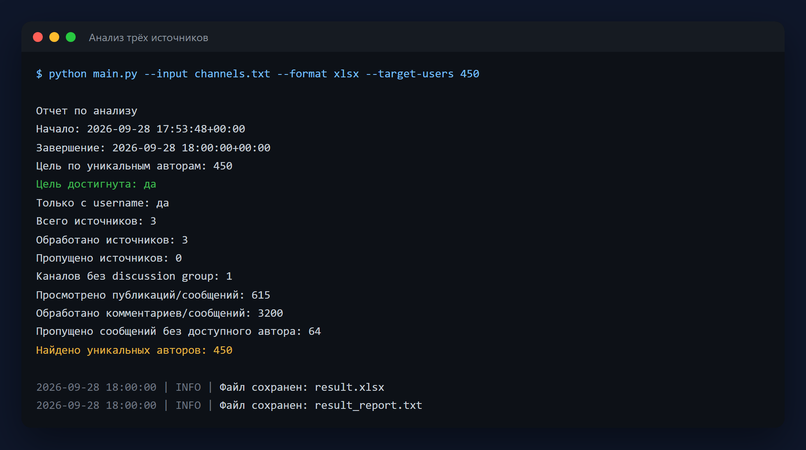
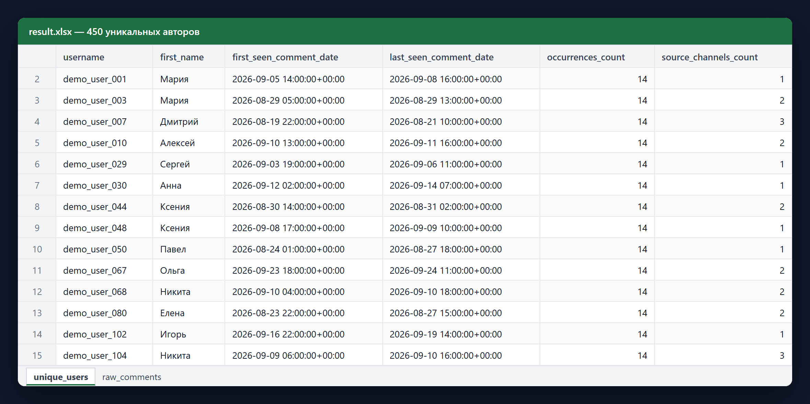

# Telegram Activity Analyzer

Консольное приложение на Python 3.11+ для анализа активности авторов комментариев и сообщений в Telegram-каналах, discussion groups и обычных группах, к которым у вас есть законный доступ.

Python 3.11 · Telethon · openpyxl · loguru



Результат — Excel-файл с уникальными авторами: сколько раз человек писал,
в скольких источниках встречался, когда был активен впервые и в последний раз.



> На скриншотах выдуманные каналы и пользователи (`demo_user_*`).

## Важные ограничения и предупреждение

Этот проект предназначен только для законного и согласованного анализа публично доступных данных пользователей, которые сами оставили комментарии в обсуждениях.

Запрещенные сценарии использования:

- спам и массовые рассылки;
- обход лимитов и ограничений Telegram;
- скрытый сбор персональных данных;
- прокси-ротация, антибан-логика, автоконтакт;
- анализ чатов и каналов без права доступа и без законных оснований на обработку данных.

Приложение намеренно не содержит функций отправки сообщений, инвайта пользователей, массовой рассылки, автоматического контакта или обхода ограничений Telegram.

## Возможности

- принимает список ссылок на каналы, discussion groups или обычные группы из файла;
- определяет, есть ли у канала связанная discussion group;
- проходит по последним `N` постам;
- получает комментарии к постам;
- извлекает только авторов комментариев;
- для обычных групп анализирует последние `N` сообщений и извлекает их авторов;
- дедуплицирует пользователей по `user_id`;
- экспортирует данные в `CSV` или `XLSX`;
- формирует аналитический отчет;
- поддерживает `dry-run` без экспорта;
- по умолчанию сохраняет только пользователей с публичным username;
- поддерживает фильтр по дате комментариев;
- останавливается после нахождения заданного количества уникальных авторов, по умолчанию 450;
- поддерживает полный проход по всей доступной истории обычной группы;
- ограничивает максимальное ожидание FloodWait, чтобы процесс не зависал на часы;
- корректно логирует пропуски и RPC/FloodWait-ошибки.

## Структура проекта

- `main.py`
- `config.py`
- `telegram_client.py`
- `channel_analyzer.py`
- `exporters.py`
- `models.py`
- `utils.py`
- `requirements.txt`
- `.env.example`
- `channels.example.txt` — пример входного файла

## Установка

1. Убедитесь, что используется Python 3.11 или новее.
2. Создайте и активируйте виртуальное окружение.
3. Установите зависимости:

```bash
pip install -r requirements.txt
```

## Как получить API_ID и API_HASH

1. Откройте `https://my.telegram.org`.
2. Войдите под своим Telegram-аккаунтом.
3. Перейдите в раздел `API development tools`.
4. Создайте приложение и получите `api_id` и `api_hash`.

Используйте эти значения только для аккаунта, которым вы имеете право пользоваться.

## Настройка .env

1. Скопируйте `.env.example` в `.env`.
2. Заполните переменные:

```env
API_ID=123456
API_HASH=your_telegram_api_hash
SESSION_NAME=telegram_activity_session
PHONE_NUMBER=
TWO_FACTOR_PASSWORD=
```

`SESSION_NAME` задает имя Telethon-сессии. `PHONE_NUMBER` необязателен, но удобен при первом входе: если указать номер в формате `+79991234567`, Telethon не будет каждый раз спрашивать его в консоли. `TWO_FACTOR_PASSWORD` тоже необязателен; безопаснее оставить его пустым и ввести пароль 2FA в локальном терминале. После успешного входа сессия будет сохранена локально.

## Какие данные нужны и откуда их взять

Для этого проекта нужны данные **Telegram API для пользовательской сессии**, а не токен Telegram-бота.

Что именно нужно:

- `API_ID` - числовой идентификатор приложения Telegram;
- `API_HASH` - секретный хеш приложения Telegram;
- `SESSION_NAME` - любое удобное имя локальной сессии, его вы придумываете сами.
- `PHONE_NUMBER` - необязательный номер телефона для первого интерактивного входа.
- `TWO_FACTOR_PASSWORD` - необязательный облачный пароль Telegram 2FA, если скрытый ввод в вашей консоли не работает.

Где взять:

1. Откройте `https://my.telegram.org`.
2. Войдите под тем Telegram-аккаунтом, через который будете анализировать доступные вам каналы и обсуждения.
3. Откройте раздел `API development tools`.
4. Создайте приложение.
5. Скопируйте:
   - `api_id` в `.env` как `API_ID`
   - `api_hash` в `.env` как `API_HASH`

Что куда вставлять:

```env
API_ID=12345678
API_HASH=0123456789abcdef0123456789abcdef
SESSION_NAME=my_telegram_session
PHONE_NUMBER=+79991234567
TWO_FACTOR_PASSWORD=
```

Важно:

- `API_ID` должен быть числом;
- `API_HASH` вставляется строкой как есть;
- `SESSION_NAME` может быть любым, например `work_session`, `analytics_session`, `telegram_activity_session`;
- `PHONE_NUMBER` можно оставить пустым, тогда Telethon спросит номер в терминале;
- `TWO_FACTOR_PASSWORD` лучше оставить пустым; заполняйте его только если терминал не дает ввести пароль 2FA интерактивно;
- токен от `@BotFather` для этого проекта **не нужен**;
- код подтверждения и пароль 2FA вводятся только при первом запуске Telethon, если Telegram их запросит.

Если вы видите где-то `BOT_TOKEN`, это другой сценарий, связанный с Telegram Bot API. В этом проекте используется `Telethon` и вход через пользовательскую Telegram-сессию.

## Пример channels.txt

Файл `channels.txt` должен содержать по одной ссылке или username в строке:

```text
https://t.me/durov
https://t.me/example_channel
https://t.me/example_discussion_group
https://t.me/example_group
```

Пустые строки и строки, начинающиеся с `#`, игнорируются.

## Запуск

Базовый запуск:

```bash
python main.py --input channels.txt --limit-posts 100 --limit-comments-per-post 1000 --output result.csv --format csv
```

Экспорт в Excel:

```bash
python main.py --input channels.txt --output result.xlsx --format xlsx
```

Только пользователи с username, режим включен по умолчанию:

```bash
python main.py --input channels.txt --only-with-username
```

Включить пользователей без username:

```bash
python main.py --input channels.txt --include-without-username
```

Фильтр по дате:

```bash
python main.py --input channels.txt --since 2026-01-01
```

Dry-run без экспорта:

```bash
python main.py --input channels.txt --dry-run
```

Найти 450 уникальных пользователей и остановиться:

```bash
python main.py --input channels.txt --target-users 450 --output result.csv
```

Ограничить ожидание FloodWait:

```bash
python main.py --input channels.txt --max-flood-wait 120
```

Собрать всех авторов, которые писали в обычной группе:

```bash
python main.py --input channels.txt --all-messages --output group_users.xlsx --format xlsx
```

## CLI-параметры

- `--input channels.txt` - путь к входному файлу;
- `--limit-posts 100` - сколько последних постов канала или сообщений группы просматривать, если `--target-users` отключен;
- `--limit-comments-per-post 1000` - сколько комментариев забирать на пост канала;
- `--output result.csv` - основной файл экспорта;
- `--format csv|xlsx` - формат экспорта;
- `--dry-run` - выполнить анализ без сохранения файлов;
- `--max-flood-wait 300` - максимальное ожидание FloodWait в секундах; если Telegram просит больше, текущий источник пропускается;
- `--target-users 450` - остановиться после нахождения указанного количества уникальных пользователей с учетом фильтра username; `0` отключает эту остановку;
- `--only-with-username` - выгружать только пользователей с username; включено по умолчанию;
- `--include-without-username` - включить в выгрузку пользователей без публичного username;
- `--all-messages` - для обычной группы пройти по всей доступной истории сообщений и собрать всех авторов;
- `--since YYYY-MM-DD` - брать только комментарии начиная с указанной даты.

## Что сохраняется

Для каждого автора комментария сохраняются:

- `user_id`
- `username`
- `profile_url`
- `first_name`
- `last_name`
- `is_bot`
- `source_channel`
- `source_post_id`
- `comment_date`

Для обычных групп поле `source_post_id` содержит `id` сообщения группы, из которого был извлечен автор.

Если используется `--target-users`, приложение продолжает читать доступную историю источников, пока не найдет нужное количество уникальных пользователей или пока источники не закончатся. Если используется `--all-messages`, для обычной группы будут просмотрены все доступные сообщения истории, а не только последние `N`.

Результат включает:

- уникальный список пользователей по `user_id`;
- полную историю вхождений комментариев;
- текстовый аналитический отчет рядом с экспортом.

## Форматы экспорта

### CSV

- основной файл: уникальные пользователи;
- дополнительный файл `*_raw_comments.csv`: полная история комментариев;
- дополнительный файл `*_report.txt`: аналитический отчет.

Все CSV-файлы записываются в `UTF-8 BOM`, чтобы корректно открываться в Excel.

### XLSX

Файл содержит два листа:

- `unique_users`
- `raw_comments`

Дополнительно рядом создается `*_report.txt`.

## Запуск в PyCharm

1. Откройте папку проекта в PyCharm.
2. Выберите интерпретатор Python 3.11+.
3. Установите зависимости из `requirements.txt`.
4. Создайте файл `.env` на основе `.env.example`.
5. Создайте конфигурацию запуска:
   - `Run | Edit Configurations...`
   - тип: `Python`
   - `Script path`: путь к `main.py`
   - `Working directory`: корень проекта
   - `Parameters`: например `--input channels.txt --output result.xlsx --format xlsx`
6. Запустите конфигурацию.

## Ограничения Telegram и поведение приложения

- если связанная discussion group отсутствует, канал логируется и пропускается;
- если ссылка ведет на обычную группу или супергруппу без связанного канала, анализируются сообщения самой группы;
- если discussion group недоступна или Telegram не дает доступ, приложение логирует ситуацию и продолжает работу;
- при `FloodWait` выполняется безопасное ожидание и повтор;
- если `FloodWait` больше `--max-flood-wait`, текущий источник пропускается, а приложение продолжает обработку остальных ссылок;
- при первом входе отправка кода, проверка кода и проверка 2FA-пароля имеют таймаут 60 секунд, чтобы процесс не висел бесконечно;
- если Telegram возвращает `AuthRestartError` во время первого входа, приложение делает ограниченный повтор авторизации и затем показывает понятную ошибку без traceback;
- при части RPC-ошибок выполняются ограниченные ретраи;
- инструмент работает только через стандартные возможности Telethon и не использует обходные техники.

## Замечания по безопасности

- проверяйте, что у вас есть право на обработку данных в конкретном сценарии;
- не анализируйте закрытые сообщества без разрешения;
- не используйте выгрузки для рассылок, рекламы или deanonymization;
- храните `.env` и файлы сессии Telethon в безопасном месте.

## Лицензия

MIT — см. [LICENSE](LICENSE).
